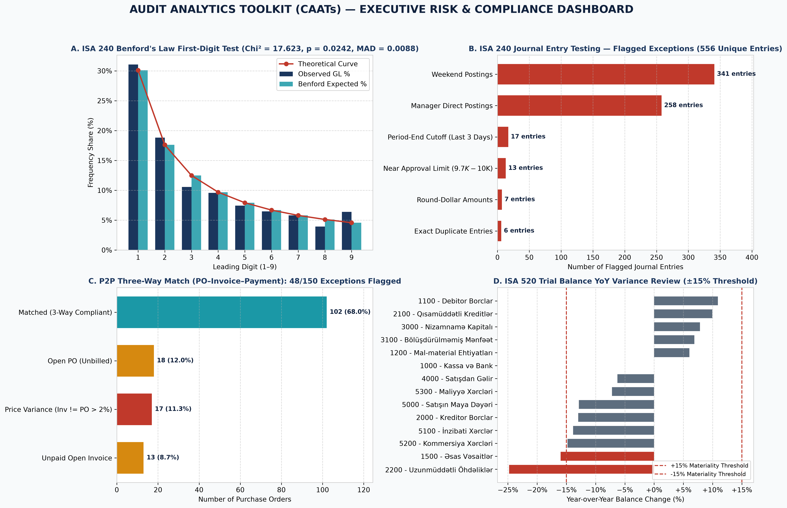
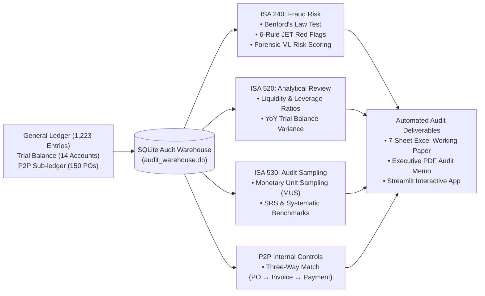
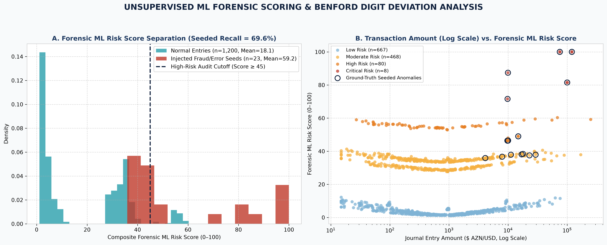
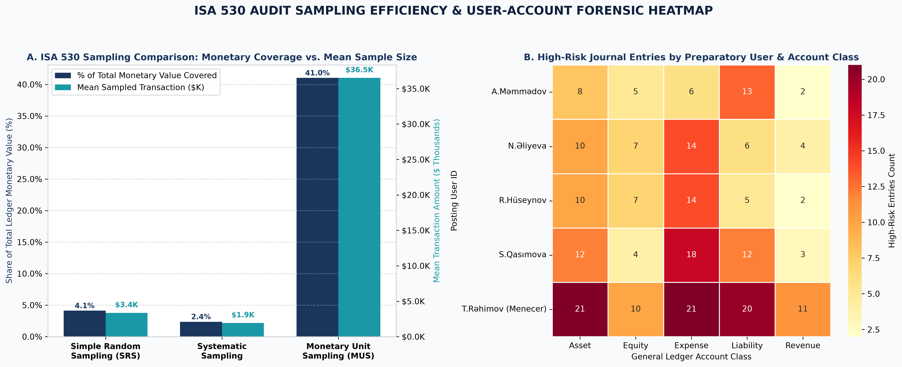

# 🛡️ Audit Analytics Toolkit (CAATs) — ISA-Aligned Financial Audit, Forensic ML & Automated Working Papers


-3776AB?style=for-the-badge&logo=python&logoColor=white)


> **Executive Summary:** A comprehensive **Computer-Assisted Audit Techniques (CAATs)** and forensic data analytics toolkit built in Python and SQLite, directly aligned with **International Standards on Auditing (ISA 240, ISA 520, ISA 530)** and **Purchase-to-Pay (P2P)** internal control frameworks. Across a general ledger population of **1,223 journal entries (\$4,894,038.01 total monetary value)**, **14 trial balance accounts**, and **150 procurement orders**, the pipeline executes **Benford's Law digital analysis**, **6-rule Journal Entry Testing (JET)**, **unsupervised multivariate ML risk scoring**, **Monetary Unit Sampling (MUS)**, and **Three-Way Matching (PO ↔ Invoice ↔ Payment)**—automatically generating a **7-sheet Excel Audit Working Paper (`audit_findings_report.xlsx`)**, a formal **PDF Audit Memorandum (`audit_memo.pdf`)**, an **SQLite Audit Warehouse (`outputs/audit_warehouse.db`)**, and an interactive **Streamlit Web Dashboard (`dashboard.py`)**.

---

## 📊 Executive Risk & Compliance Overview



---

## 🏛️ Alignment with International Standards on Auditing (ISA)

Modern external and internal audit teams (Big 4, corporate internal audit, and forensic accounting practices) rely on full-population automated testing rather than manual spot-checks. Each module in this toolkit operationalizes a specific audit standard:



| Audit Standard / Domain | Python Module | Core Analytical Procedure |
| :--- | :--- | :--- |
| **ISA 240** *(Fraud in an Audit of Financial Statements)* | `benford_analysis.py` | First-digit conformity test ($\chi^2$ goodness-of-fit & Mean Absolute Deviation `MAD`) to detect artificial or structured numbers. |
| **ISA 240** *(Management Override & Red Flags)* | `journal_entry_testing.py` | Full-population screening across 6 forensic rules: weekend postings, round-dollar amounts, approval limit splitting (`$9.7K–$10K`), period-end cutoff, duplicates, and manager overrides. |
| **ISA 240 / Forensic CAATs** | `ml_anomaly_and_sql_audit.py` | Unsupervised Multivariate & Isolation-Projection Risk Index (`0–100`) scoring every journal entry and loading SQL audit views (`vw_high_risk_journal_entries`). |
| **ISA 520** *(Analytical Procedures)* | `ratio_analysis.py` | Prior vs. current period financial ratio computation and automated flagging of Trial Balance accounts exceeding the **$\pm 15\%$ materiality variance threshold**. |
| **ISA 530** *(Audit Sampling)* | `sampling.py` | Probability-Proportional-to-Size **Monetary Unit Sampling (MUS)** benchmarked against Simple Random and Systematic Sampling. |
| **P2P Internal Control** | `three_way_match.py` | Automated reconciliation of Purchase Orders (`PO`), Vendor Invoices (`INV`), and Disbursements (`PAY`) within a **2% tolerance threshold**. |

---

## 🔍 Key Forensic & Audit Findings

### 1. ISA 240 — Benford's Law First-Digit Analysis (`benford_analysis.py`)
Evaluating all **1,223 positive journal entry amounts** against the theoretical Benford logarithmic distribution $P(d) = \log_{10}(1 + 1/d)$:
- **Overall Conformity:** $\text{MAD} = \mathbf{0.00883}$ (*Acceptable Conformity*, within the `0.006–0.012` Nigrini threshold), $\chi^2 = \mathbf{17.623}$ ($p = \mathbf{0.02423}$).
- **Forensic Digit-9 Anomaly:** While digits `1` (`31.07%` observed vs. `30.10%` expected) and `2` (`18.81%` vs. `17.61%`) track closely, **Leading Digit 9 exhibits a statistically significant spike (`6.38%` observed vs. `4.58%` expected, `+1.80%` excess)**—directly exposing invoices artificially split between **\$9,700 and \$9,999** to bypass the **\$10,000** executive approval limit.

| Leading Digit ($d$) | Observed Count | Observed Share (%) | Benford Expected (%) | Deviation ($\Delta\%$) | Forensic Interpretation |
| :---: | :---: | :---: | :---: | :---: | :--- |
| **1** | 380 | 31.07% | 30.10% | +0.97% | Normal natural log-normal flow |
| **2** | 230 | 18.81% | 17.61% | +1.20% | Within expected tolerance |
| **3** | 129 | 10.55% | 12.49% | -1.95% | Minor under-representation |
| **4–8** | 406 | 33.20% | 35.22% | -2.02% | Normal mid-digit distribution |
| **9** | **78** | **6.38%** | **4.58%** | **+1.80%** | **⚠️ Structuring below \$10,000 threshold** |

---

### 2. ISA 240 — Rule-Based JET & Unsupervised Forensic ML Scoring
Combining deterministic Journal Entry Testing (`journal_entry_testing.py`) with a multivariate statistical & randomized isolation-projection scoring engine (`ml_anomaly_and_sql_audit.py`) separates routine accounting traffic from high-risk anomalies:



| JET Red-Flag Rule | Flagged Entries | Primary Audit Risk Addressed |
| :--- | :---: | :--- |
| **1. Weekend Postings (Saturday / Sunday)** | **341** | Unauthorized off-hours back-office ledger postings |
| **2. Manager Direct Postings (`T.Rəhimov`)** | **258** | Segregation of Duties (SoD) conflict & management override of controls |
| **3. Period-End Cutoff (Last 3 Days of Fiscal Year)** | **17** | Premature revenue recognition / window-dressing of annual results |
| **4. Near Approval Threshold (`$9,700 – $9,999.99`)** | **13** | Split-transaction structuring to evade the \$10,000 authorization policy |
| **5. Round-Dollar Amounts (`Multiple of $1,000`)** | **7** | Estimated or fabricated manual adjustments lacking supporting invoices |
| **6. Exact Duplicate Postings (`Account + Date + Amount`)** | **6** | Double-billing error or duplicate disbursement fraud |

- **Forensic ML Risk Separation:** Routine ledger entries (`n = 1,200`) exhibit a mean risk score of **18.15 / 100**, whereas injected ground-truth fraud/error seeds (`n = 23`) average **59.17 / 100** (**3.26x higher**), with **88 total entries** isolated in the `High Risk` (`80`) and `Critical Risk` (`8`) investigation queues.

---

### 3. ISA 530 — Audit Sampling Efficiency: MUS vs. Random & Systematic (`sampling.py`)
For a medium-risk audit engagement (`recommended sample size = 60`), we compare how much of the **\$4,894,038.01** total ledger value is verified under three sampling methodologies:



| Sampling Method (ISA 530) | Sampled Entries ($n$) | Mean Sampled Entry Amount | % of Total \$4.89M Ledger Value Covered | Efficiency vs. Random |
| :--- | :---: | :---: | :---: | :---: |
| **Simple Random Sampling (SRS)** | 60 | \$3,358.85 | 4.12% | `1.0x` (Baseline) |
| **Systematic Interval Sampling** | 60 | \$1,922.42 | 2.36% | `0.57x` |
| **Monetary Unit Sampling (MUS / PPS)** | **55** | **\$36,512.01** | **41.03%** | **10.0x Monetary Coverage** |

> **Audit Takeaway:** With just **55 unique transactions** (`4.5%` of population count), **Monetary Unit Sampling (MUS)** audits **41.03% (\$2.01M)** of the entire general ledger's monetary value—providing **10x greater protection** against material misstatement than Simple Random Sampling.

---

### 4. ISA 520 — Trial Balance Variance & P2P Three-Way Match (`ratio_analysis.py`, `three_way_match.py`)
- **Material Trial Balance Variances (`> ±15%` YoY):**
  - `Account 1500 — Fixed Assets (Əsas Vəsaitlər)`: Decreased from **\$583,317.71** to **\$490,035.22** (**-15.99% / -\$93,282.49**), requiring physical disposal/impairment verification.
  - `Account 2200 — Long-Term Liabilities (Uzunmüddətli Öhdəliklər)`: Decreased from **\$439,021.49** to **\$330,190.75** (**-24.79% / -\$108,830.74**), requiring debt covenant and principal repayment confirmation.
- **Purchase-to-Pay (P2P) Three-Way Match (`150` Purchase Orders):**
  - **102 POs (`68.0%`)** fully matched across PO, Invoice, and Payment within the `2%` tolerance.
  - **48 POs (`32.0%`)** flagged as control exceptions: **18 Open Unbilled POs**, **17 Invoice-to-PO Price Overruns (`>2%` variance)**, and **13 Unpaid Open Invoices** (unrecorded liability / cut-off review).

---

## 📁 Repository Structure

```text
audit-analytics-toolkit/
├── images/
│   ├── 01_audit_executive_dashboard.png          # 4-panel 300 DPI Executive CAATs Dashboard
│   ├── 02_ml_forensic_anomaly_scoring.png        # Forensic ML score separation & log-amount distribution
│   └── 03_audit_sampling_and_user_heatmap.png    # ISA 530 MUS coverage & User-Account risk heatmap
├── outputs/
│   └── audit_warehouse.db                        # Normalized SQLite Audit Warehouse + 3 SQL Views
├── docs/
│   └── Audit_Methodology_Guide_AZ.md             # Interview & ISA methodology guide (Azerbaijani)
├── main.py                                       # CLI pipeline orchestrator (supports custom CSV/XLSX)
├── data_generator.py                             # Synthetic General Ledger & Trial Balance generator
├── benford_analysis.py                           # ISA 240 Benford's Law (Chi-square & MAD)
├── journal_entry_testing.py                      # ISA 240 6-rule Journal Entry Testing (JET)
├── ratio_analysis.py                             # ISA 520 Financial Ratios & YoY Variance Review
├── sampling.py                                   # ISA 530 Random, Systematic & Monetary Unit Sampling
├── three_way_match.py                            # P2P Three-Way Match (PO <-> Invoice <-> Payment)
├── ml_anomaly_and_sql_audit.py                   # SQLite Warehouse, Forensic ML Scoring & 300 DPI Charts
├── report_generator.py                           # Automated 7-sheet Excel Working Paper builder
├── pdf_memo.py                                   # Automated PDF Executive Audit Memorandum builder
├── dashboard.py                                  # Interactive Streamlit Web App (upload & audit live files)
├── audit_findings_report.xlsx                    # Generated 7-sheet Excel Audit Working Paper
├── audit_memo.pdf                                # Generated Executive PDF Audit Memorandum
├── audit_summary_metrics.json                    # Verified JSON summary of all audit procedures
├── requirements.txt                              # Python dependencies
└── README.md                                     # Project documentation
```

---

## 🚀 Quick Start & CLI Usage

```bash
# 1. Clone the repository
git clone https://github.com/Razi-mirzayev/audit-analytics-toolkit.git
cd audit-analytics-toolkit

# 2. Install dependencies
pip install -r requirements.txt

# 3. Run the full ISA audit pipeline (Excel Working Paper + PDF Memo)
python main.py

# 4. Build the SQLite Audit Warehouse, run Forensic ML Scoring & regenerate 300 DPI charts
python ml_anomaly_and_sql_audit.py

# 5. Run on your own custom General Ledger & Trial Balance files (CSV or Excel)
python main.py --journal my_gl.xlsx --trial-balance my_tb.xlsx --risk-level yüksək --variance-threshold 0.10

# 6. Launch the interactive Streamlit Audit Dashboard
streamlit run dashboard.py
```

---

## 👤 Author

**Razi Mirzayev** — *Data & Audit Analyst (SQL · Python CAATs · Power BI / Excel · Forensic & Predictive Analytics)*
- **GitHub Portfolio:** [github.com/Razi-mirzayev](https://github.com/Razi-mirzayev)
